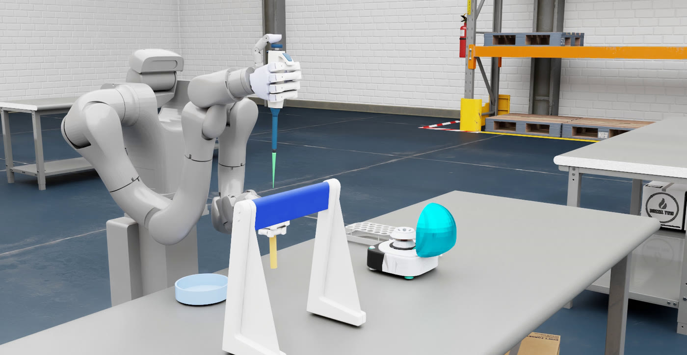
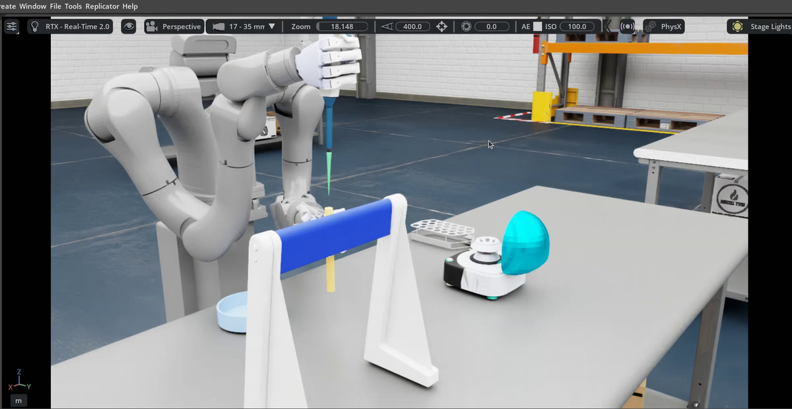
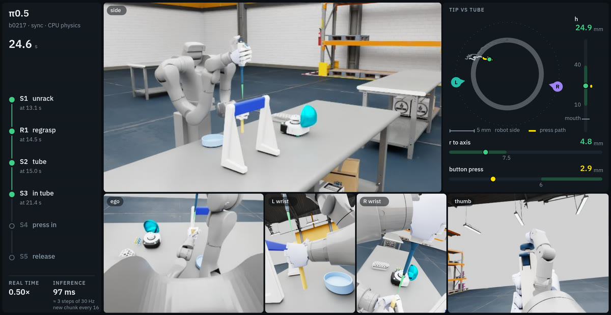

# Humanoid Lab Manipulation in Simulation

Our fine-tuned pi0.5 vision-language-action policy controls a Vega-U humanoid with Wuji Hand 2 robotic hands.
The robot picks up a pipette and a centrifuge tube, aligns the tip over the tube opening, then presses and releases
the plunger.

The simulation runs in Isaac Sim 6.0.1 with Isaac Lab. Watch the robot in the simulator and live browser dashboard,
or run it in the background and save an evaluation video.

> **Disclaimer:** This demo showcases work in progress. The policy was not trained to follow proper laboratory
> practice; its behavior should not be taken as guidance on lab technique.



The policy uses images from four cameras, the robot's joint positions, and a task description to choose its actions.
Policy weights and evaluation results are available in the
[model card](https://huggingface.co/birbirll/vega-wuji-pipette-pi05).

## Requirements

- Linux x86_64 and an NVIDIA GPU with at least 24 GB of VRAM. The driver must support Isaac Sim 6.0.1 and
  CUDA 12.
- About 55 GB of free disk space.
- [`uv`](https://docs.astral.sh/uv/) 0.12.15 or newer, plus internet access for setup and for the warehouse room
  scene, which is streamed from NVIDIA at run time.
- An X11 desktop and a browser to watch runs live.
- `ffmpeg` to generate evaluation videos.

## Installation

The simulator and policy server use separate Python environments. Follow the three steps below from the
repository root to set up both environments, download the assets, and configure the run scripts.

### 1. Set up the simulator

Install Isaac Sim, Isaac Lab, and this package (about 30 GB):

```bash
uv venv --python 3.12 ~/envs/vega-isaac && source ~/envs/vega-isaac/bin/activate
uv pip install "isaacsim[all,extscache]==6.0.1.0" --extra-index-url https://pypi.nvidia.com \
  --index-strategy unsafe-best-match --prerelease=allow
uv pip install torch==2.10.0 torchvision==0.25.0 --index-url https://download.pytorch.org/whl/cu128
git clone https://github.com/isaac-sim/IsaacLab.git ~/envs/IsaacLab
git -C ~/envs/IsaacLab checkout ffff603eafc6
~/envs/IsaacLab/isaaclab.sh --install core
uv pip install -e . && deactivate
```

### 2. Set up the policy server

Install openpi with the local adaptations in `policy_server/openpi_overlay/` (about 10 GB):

```bash
git clone https://github.com/Physical-Intelligence/openpi.git ~/envs/openpi
git -C ~/envs/openpi checkout 215abfb217db
cp -r policy_server/openpi_overlay/. ~/envs/openpi/
(cd ~/envs/openpi && GIT_LFS_SKIP_SMUDGE=1 uv sync --frozen)
```

### 3. Download the assets and configure the scripts

Download the policy checkpoint from Hugging Face (about 12 GB) with the policy environment's `huggingface-cli`,
then the packing table model, and copy the example configuration:

```bash
~/envs/openpi/.venv/bin/huggingface-cli download birbirll/vega-wuji-pipette-pi05 \
  --local-dir checkpoints/vega-wuji-pipette-pi05
python3 tools/fetch_packing_table.py      # the packing table model (see NOTICE)
cp config/vega.env.example config/vega.env
```

Edit `config/vega.env` to point to the two Python environments:

```ini
VEGA_ISAAC_PY=~/envs/vega-isaac/bin/python
VEGA_POLICY_PY=~/envs/openpi/.venv/bin/python
```

After reading and accepting the NVIDIA Omniverse License Agreement, set `OMNI_KIT_ACCEPT_EULA=YES` in the same file.

## Run the simulation

**GUI:** open the simulator window and the live dashboard, which the script opens in your browser at
`http://localhost:8765`.

```bash
scripts/run_sim_gui.sh
```

**Headless:** run in the background and save an evaluation video.

```bash
scripts/run_sim_headless.sh
```

Both run scripts load `config/vega.env` and handle starting and stopping the policy server. The first launch takes
a few minutes while the model compiles.

Every run places the pipette stand, the pipette, the tube rack and the tube at random, within the ranges the policy
was trained on, so success varies from run to run. Each run stops three simulated seconds after success or failure,
or at the 40-second limit, whichever comes first. Run one script at a time, since they share the policy server port (5555) and the GPU.

The GUI dashboard shows task progress, the side view and four policy cameras, pipette-to-tube alignment, and
simulation speed. Close the simulator window or press Ctrl+C to end a GUI run early.

The headless script prints the log location and a command to follow the run's progress. Videos are saved to
`runs/videos/` and use the same layout as the dashboard.

<p> </p>

### Other run patterns and arguments

Headless runs offer three video options:

| Option | Output |
|---|---|
| `standard` (default) | A 1544 × 798 video using camera footage from the run. |
| `hires` | A 3088 × 1596 video made by replaying the logged motion with each camera's width and height tripled. |
| `both` | Both videos from the same run. |

For example, generate both videos with:

```bash
scripts/run_sim_headless.sh both
```

The full command syntax is shown below. Items in brackets are optional; replace uppercase placeholders with your
own values.

```text
scripts/run_sim_gui.sh [cpu|gpu] [--no-dashboard] [-- LIVE_OPTIONS]
scripts/run_sim_headless.sh [standard|hires|both] [gpu|cpu] [--runs N] [--steps N]
```

Use `--no-dashboard` to open only the simulator window. For headless runs, `--steps N` changes the default limit of
1200 control steps (40 seconds of task time), and `--runs N` runs N times one after another, each with a new random
placement.

The GUI script passes any arguments after `--` to the simulation runner. For example, this lets the robot keep
moving while the policy computes the next batch of actions:

```bash
scripts/run_sim_gui.sh -- --inference-mode async
```

For all runner options, run `python -m vega_pipette.live --help` in the simulation environment.

## Task progress

The dashboard and evaluation videos track five main milestones:

- **S1:** Lift the pipette off the stand.
- **S2:** Pick up the tube from the rack.
- **S3:** Align the pipette tip with the tube opening.
- **S4:** Press the plunger to the first stop.
- **S5:** Release the plunger to complete the task.

They also track **R1**, when the robot adjusts its grip to press the plunger. This regrasp is recorded separately
and is not required for success.

## Performance

Each 30 Hz control step steps the physics, renders the four policy cameras and the side view, and runs the policy,
which plans 16 actions per query. The GUI uses CPU physics by default: it runs about twice as fast as GPU physics,
which keeps the live view closer to real time. Headless runs use GPU physics, the physics the policy was trained and
evaluated with, since speed matters less when nobody is watching. Pass `cpu` or `gpu` to either run script, or set
`VEGA_DEVICE` in `config/vega.env`, to choose. The real-time factor is simulated task time divided by elapsed
wall-clock time: 1.0 means real time, while 0.5 means the simulation runs at half speed.


<sub>Measured on an NVIDIA RTX 4090 with an Intel Core i9-14900KF.</sub>

## Repository

| Path | Contents |
|---|---|
| `vega_pipette/` | Simulation package: task scene (`env/`), runner (`live.py`), policy client, scorer, dashboard, and video tools. |
| `policy_server/` | A pi0.5 inference server built with openpi and JAX, running in its own environment. |
| `scripts/` | The two run scripts and their shared settings (`env.sh`). |
| `assets/` | Robot and prop models. |
| `tools/` | Asset download scripts and a repository release check. |

## License

The code is licensed under the Apache License 2.0; third-party components retain their own licenses
(see [NOTICE](NOTICE)). The policy weights are fine-tuned from the openpi pi0.5 base model, which is derived from
PaliGemma, and their use is subject to the Gemma Terms of Use; see the
[model card](https://huggingface.co/birbirll/vega-wuji-pipette-pi05) and [NOTICE](NOTICE).
