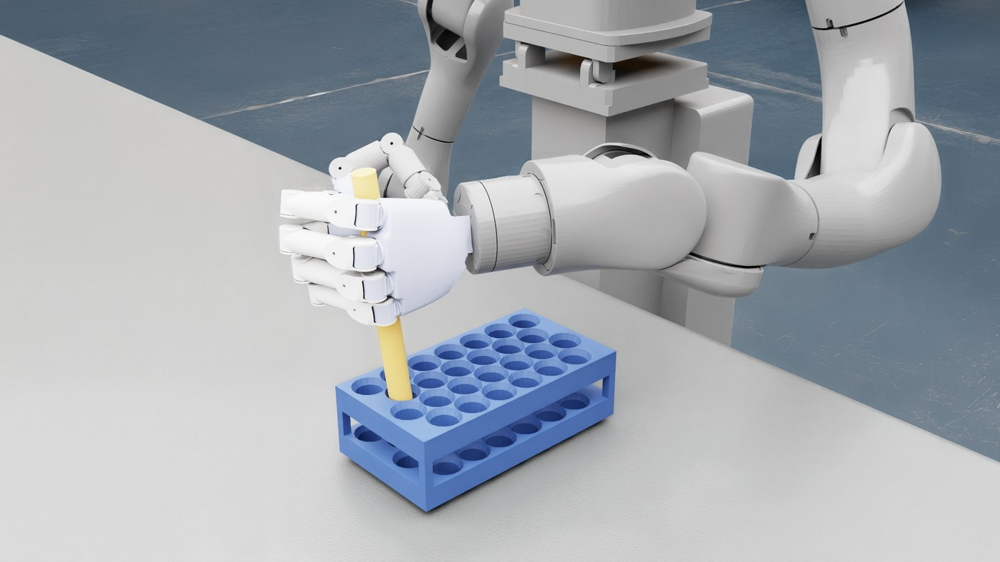
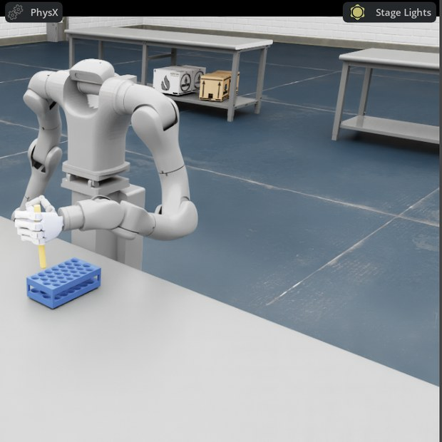
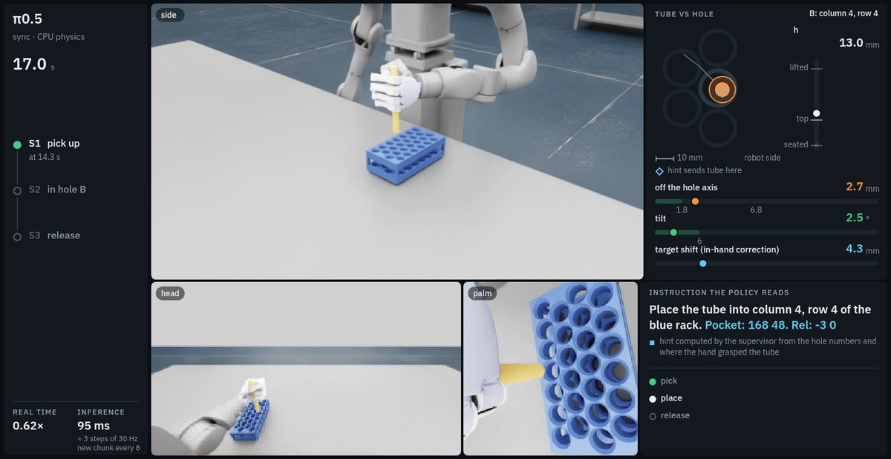

# Humanoid Lab Manipulation in Simulation: Tube Pick-and-Place

Our fine-tuned pi0.5 vision-language-action policy controls a Vega-U humanoid with Wuji Hand 2 robotic hands. With
its left hand, the robot takes a centrifuge tube out of one hole of a rack and puts it into another hole.

A simple supervisor runs alongside the policy and does two things: it switches the instruction from one phase of the
task to the next, and it computes a hint for the place phase, the hand position that puts the tube into the target
hole, written into the instruction as numbers ("Pocket" and "Rel", see
[What the policy is given](#what-the-policy-is-given)). The policy does not work out that position by itself.

This branch adds the tube task to the [main branch](https://github.com/LidarDexManip/vega_pipette_sim_demo/tree/main).
The main branch's pipetting task runs here unchanged and is documented in the main README.

The simulation runs in Isaac Sim 6.0.1 with Isaac Lab. Watch the robot in the simulator and live browser dashboard,
or run it in the background and save an evaluation video.

> **Disclaimer:** This demo showcases work in progress. The policy was not trained to follow proper laboratory
> practice; its behavior should not be taken as guidance on lab technique.



Policy weights are available in the [model card](https://huggingface.co/birbirll/vega-tube-pnp).

## Installation

Follow the [Requirements and Installation of the main README](https://github.com/LidarDexManip/vega_pipette_sim_demo/tree/main#installation).
This branch needs, in addition:

- About 12 GB more disk space, for the tube task's checkpoint.
- The checkpoint, downloaded with the policy environment's `huggingface-cli`:

  ```bash
  ~/envs/openpi/.venv/bin/huggingface-cli download birbirll/vega-tube-pnp --local-dir checkpoints/vega-tube-pnp
  ```

- To keep the checkpoint elsewhere, set `VEGA_PICK_PLACE_CHECKPOINT` in `config/vega.env`.

No other dependency is needed.

## Run the simulation

**GUI:** open the simulator window and the live dashboard, which the script opens in your browser at
`http://localhost:8765`.

```bash
scripts/run_sim_gui.sh pick-place
```

**Headless:** run in the background and save an evaluation video.

```bash
scripts/run_sim_headless.sh pick-place
```

The first word picks the task: `pick-place` for the tube task, `pipette` (or nothing) for the pipetting task. Both
run scripts load `config/vega.env` and handle starting and stopping the policy server. The first launch takes a few
minutes while the model compiles.

Every run places the rack at random within the range the policy was trained on, and picks the hole the tube starts in
and the hole it should go to, so success varies from run to run. A run stops one second after the hand lets go of
the tube, or at the 63-second limit. Run one script at a time, since they share the policy server port (5555;
`VEGA_POLICY_PORT` in `config/vega.env`) and the GPU.

The GUI dashboard shows task progress, the side view and both policy cameras as the policy sees them, the
instruction as the policy reads it, where the tube is relative to its target hole, and simulation speed. Close the
simulator window or press Ctrl+C to end a GUI run early.

The headless script prints the log location and a command to follow the run's progress. Videos are saved to
`runs/videos/` and use the same layout as the dashboard.

<p> </p>

### Other run patterns and arguments

Headless runs offer three video options:

| Option | Output |
|---|---|
| `standard` (default) | A 1544 × 798 video using camera footage from the run. |
| `hires` | A 3088 × 1596 video made by replaying the logged motion with each camera's width and height tripled. |
| `both` | Both videos from the same run. |

For example, generate both videos with:

```bash
scripts/run_sim_headless.sh pick-place both
```

The full command syntax is shown below. Items in brackets are optional; replace uppercase placeholders with your
own values.

```text
scripts/run_sim_gui.sh pick-place [--no-dashboard] [-- LIVE_OPTIONS]
scripts/run_sim_headless.sh pick-place [standard|hires|both] [--runs N] [--steps N]
```

Use `--no-dashboard` to open only the simulator window. For headless runs, `--steps N` changes the default limit of
1900 control steps (63 seconds of task time), and `--runs N` runs N times one after another, each with a new random
placement. The simulator has been seen to hang on rare occasions: a headless run whose simulator does not start
within 10 minutes is started again once, and a run or replay still going well past its time is stopped and reported,
and the next run starts.

The GUI script passes any arguments after `--` to the simulation runner. For example, this lets the robot keep
moving while the policy computes the next batch of actions:

```bash
scripts/run_sim_gui.sh pick-place -- --inference-mode async
```

For all runner options, run `python -m vega_pipette.pick_place --help` in the simulation environment.

The tube task runs with CPU physics, the physics its policy was trained and evaluated with; the run scripts do not
accept `gpu` for it.

## What the policy is given

The policy uses images from two cameras, the head camera and a camera on the left wrist that looks along the palm,
the robot's joint positions, and one instruction at a time:

1. "Pick up the tube from column 3, row 5 of the blue rack."
2. "Place the tube into column 1, row 4 of the blue rack. Pocket: 365 258. Rel: -7 -3"
3. "Release the tube and move the hand away."

A simple supervisor around the policy does the phase switching and computes the hint:

- **Phase switching.** It gives the policy the next instruction when the simulation shows that the phase is done.
- **Hint.** The numbers in the place instruction are the supervisor's hint; the policy does not produce them. They give
  the hand position that puts the tube into the target hole: "Pocket" is that position as two grid numbers on the table
  in front of the robot, about 0.7 mm apart, and "Rel" is how far that position is from the hand now, in 0.5 mm steps,
  refreshed at every query.

The column and row alone are not precise enough: in our evaluation, a policy trained with only them picked the tube up
in 88 of 96 starts but put it into the named hole in only 31 of those, while this policy, trained and run with the
numbers as well, placed it in 84 of the 86 it picked up.

The supervisor computes the hint from the robot's own joints, with no camera and no learned estimator: it remembers
where the hand was when it closed on the tube, adds the offset between the two holes from their numbers, and shifts
the target as the tube slips in the hand, which it estimates from the finger joints and the shape of the hand. Its
phase switching, and the scoring, use the simulation's knowledge of where the tube is. In the code the supervisor is
the task runner (`vega_pipette/pick_place.py`); the "Rel" part is refreshed by the policy server's input transform.

## Task progress

The dashboard and evaluation videos track three milestones:

- **S1:** Pick up the tube: its bottom rises 10 cm above the rack.
- **S2:** The tube is seated in the target hole: fully down, within 6° of upright and 1.8 mm of the hole's axis.
- **S3:** Release the tube: the hand opens and moves 15 cm away, and the tube stays seated for one more second. This
  completes the task.

A run fails when the tube is not picked up within 32 seconds, ends up in another hole, is dropped, or rests on or in
the rack without being seated, or when the hand has not let go within 17 seconds.

## Results

With the runner in this repository, and with the supervisor's phase switching and hint, the policy completes the
task in 73 of 96 evaluation starts (the tube is picked up in 84 of them and then placed in 73). The starts are 24 rack positions with four target holes each, including hole
pairs and target holes that were never in the training data.

## Performance

The tube task renders two 224-pixel policy cameras and the side view at every 30 Hz control step and queries the
policy every 8 actions. It runs at about 0.6× real time: simulated task time divided by elapsed wall-clock time.

<sub>Measured on an NVIDIA RTX 4090 with an Intel Core i9-14900KF.</sub>

## Repository

| Path | Contents |
|---|---|
| `vega_pipette/` | Simulation package: the two tasks' scenes (`env/`), runners (`live.py`, `pick_place.py`), policy client and the tube task's place instruction (`control/`), scorers, dashboard, and video tools. |
| `policy_server/` | A pi0.5 inference server for either policy, built with openpi and JAX, running in its own environment. |
| `scripts/` | The two run scripts and their shared settings (`env.sh`). |
| `assets/` | Robot and prop models, and the robot's kinematic description and hand shape used by the tube task. |
| `tools/` | Asset scripts and a repository release check. |

## License

The code is licensed under the Apache License 2.0; third-party components retain their own licenses
(see [NOTICE](NOTICE)). The weights of both policies are fine-tuned from the openpi pi0.5 base model, which is derived
from PaliGemma, and their use is subject to the Gemma Terms of Use; see the
[model card](https://huggingface.co/birbirll/vega-tube-pnp) and [NOTICE](NOTICE).
